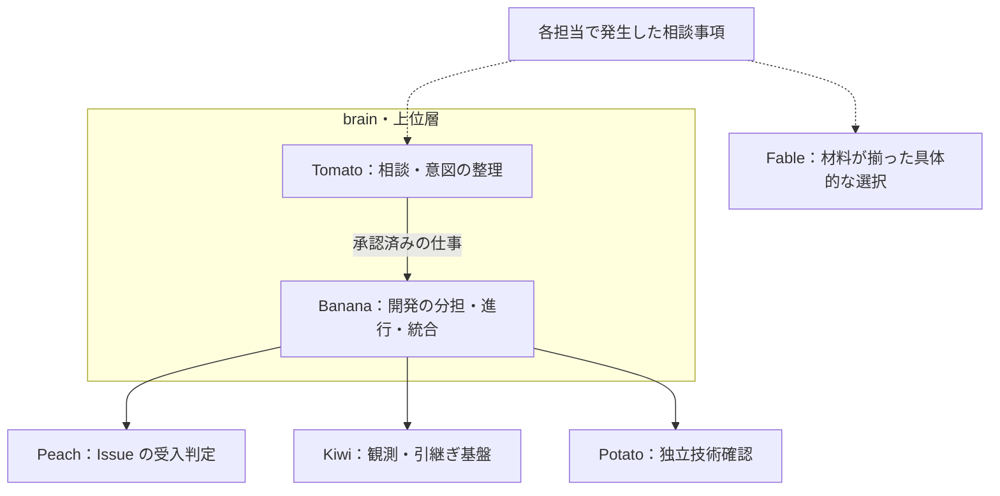

# 五役の責任と受け渡し

この契約は役割の境界を定める。現在のユーザー指示・対象プロジェクトの契約・実際の権限を優先し、起動や外部操作を新たに許可するものではない。

## 構成

brain の Tomato と Banana を上位層に置く。Tomato は持ち主との相談・意図・判断材料の窓口、Banana は承認済み開発の分担・進行・統合の責任者。
Peach・Kiwi・Potato は Banana の配下の専門担当とし、通常は Banana が依頼を割り当てて結果を回収する。
Fable は具体的な選択を確認する判断相談先。今回の五役に追加して常駐させる役ではなく、既存の判断手順を使う。

上下関係は仕事の割当・回収を表す。Peach/Potato の判定根拠・固定版・独立性を保ち、Banana が結果を都合よく変更したり、自分の実装を承認したりしない。
Orca では既存ホームを使い、Peach/Kiwi/Potato の通常の進行・回収担当を既存の Banana workspace に固定する。Tomato と Banana は同じ上位層。
役の上下関係は `roles.json` の `layer` / `parentRole` / `consultation` で管理する。Orca のネイティブな Git ワークスペースの親子関係は同じ repo・host・project 内に限られるため、異なる project にいる各役の構成には使わない。カードは移動・複製せず、確認出力の `coordinatorWorktreeId` に進行担当のホームを示す。

| 役 | 引き受ける仕事 | 成果物 | 次の担当 |
|---|---|---|---|
| Tomato | 持ち主の相談、問いと判断材料の整理、現在の事実の確認、仕事の受け渡し | 対象・承認された範囲・根拠・完了条件が明確な依頼 | 開発全体は Banana。観測基盤の単独修正は Kiwi |
| Banana | 承認済み開発の進行、Issue の担当確認、製品コードと正本の実装、検証、PR/CI、成果の統合 | AC に対応する変更と検査結果、残件の担当、依頼された終点の実証 | 基盤修正は Kiwi/Melon、技術確認は Potato、In Review の受入判定は Peach |
| Kiwi | watch、取得成功/失敗、鮮度、履歴、停止兆候、引き継ぎの観測・配送・回収の仕組みを実装する | 基盤の差分、隔離した検証、検知条件と限界 | Banana が回収・統合。相談事項は Tomato/Fable |
| Peach | Linear の status が厳密に In Review の Issue を、AC・固定 PR head・一次証拠に照らして判定する | Issue 単位の PASS / CHANGES_REQUIRED / BLOCKED レポート | Banana が結果を回収し、修正担当と次の行動を決める。相談事項は Tomato/Fable |
| Potato | 固定した差分・設定・テストを未関与の立場で調べ、技術的な不具合と回帰を指摘する | 再現条件・影響・ファイル/行・版・未確認範囲を持つ技術確認 | Banana が回収し、実装担当へ修正を割り当てる。相談事項は Tomato/Fable |

Melon は今回の五役の改編対象外。既存のレビュー基盤・packet・CI照合の実装担当を維持する。
Tomato/Banana の人格と記憶の正本は brain に残す。Kiwi/Peach/Potato はそれを継承しない。

## 重なった依頼の扱い

- 観測した「PR が止まっている」は Tomato の相談材料。原因が製品コードなら Banana、観測コードなら Kiwi。兆候だけでは担当停止や Owner 待ちを確定しない。
- 「この差分に回帰があるか」は Potato。「CAF-xxx の AC を満たしたか」は Peach。Issue が無い技術確認を Peach に送り、受入判定の代わりに Potato の結論を使わない。
- 証拠収集や判定 launcher の不具合は Melon、判定の実行は Peach。Kiwi は判定条件や証拠ゲートを所有しない。
- Banana が複数担当の結果を統合するときも、同じ変更の独立レビューを兼ねない。修正したレビュー担当は実装側に移り、未関与担当に渡す。
- 持ち主の直接依頼を受けた専門担当は、その依頼元へ結果を返してよい。通常の開発進行の割当と統合は Banana に揃え、同じ案件に複数の進行責任者を作らない。

## 相談事項の戻し先

- 意図・前提・現在の事実が曖昧、依頼同士が衝突、持ち主へどう説明するかを整理したい場合は Tomato に確認する。
- 調査済みの材料から製品範囲・優先順位・受入範囲・方針を具体的に選ぶ必要がある場合は Fable に確認する。問い・2〜4個の選択肢と代償・一次資料の原文・既存の決定と決定者を一度に揃える。手順は [Tomato の Fable 参照](/Users/kamp/.claude/skills/Tomato/references/fable.md)。
- 材料が揃った担当は委任された経路で Fable へ直接確認できる。材料不足なら Tomato と整理する。同じ問いを Tomato/Fable や複数の判断担当へ重複送信しない。
- Banana は編集範囲・担当・順序など承認済みの範囲内の進行を処理する。範囲拡大や判断の変更を専門担当が独断で確定しない。
- 相談では問い・根拠・影響・止める作業・独立して続けられる作業を明示する。確認後は誰が何を決めたかを Banana に返し、進行へ反映する。判断待ちだけを理由に無関係な作業まで止めない。
- 具体的な判断の委任、実際の連絡経路、モデル/effort は現在のユーザー指示と対象プロジェクトの契約で確認する。役名による権限拡大や自動モデル切替は行わない。

Tomato/Banana が Owner の判断・承認・本人操作で止まった場合は、
[Owner 判断待ちの手順](owner-decision.md) に従う。材料を揃えて Fable に確認し、
回答を受けたうえで推奨案付きの選択肢を Owner に提示する。Fable の推奨だけで Owner 待ちを解除しない。

## 依頼と結果

依頼には必要な情報を一度に揃える。対象 repo/checkout、Issue/PR、固定 full SHA または内容 hash、AC の正本、実際のユーザー委任、編集範囲と並行担当、完了条件、根拠ファイルと取得時刻、未確認事項を渡す。
レビューには実装・修正の関与歴と必要な model/effort も付ける。説明だけを証拠として渡さない。

依頼本文はファイルを `--prompt-file` に渡す。shell に本文を組み立てさせない。
案件の基本動作は [Banana を基準にした共通手順](project-tasks.md) に揃える。
Tomato は依頼を整理し、通常は Banana が担当・対象・完了条件を固定して共通の `banana/bin/task` へ渡す。
観測基盤の単独修正は Tomato から Kiwi へ直接渡してよい。その場合も同じ共通入口を使い、依頼元を記録する。
編集担当の Banana/Kiwi/Melon は案件用 worktree、読み取り担当は指定 checkout、Peach は既存の evidence pipeline を使う。
各担当ホームを増やさず、依頼 ID ごとに受領・作成・実行・結果を確認する。共通入口への投入だけを着手承認や追加権限と読まない。
結果には確認した版、成果物、検査と終了コード、未確認の理由、残件と次の担当を付ける。
受け渡し先への送信や外部投稿は現在のユーザー委任が許す経路で行う。未許可なら依頼ファイルを準備して返す。

## Orca の運用

実際に使う executable が返す `orca-cli` を読む。監督付きの task/Run/DAG、ask/reply を使う場合だけ `orchestration` も読む。
作業 checkout とタブを置く workspace は別の識別子として記録し、Orca が返した完全な worktree ID と唯一の terminal handle を使う。
名前だけ・起動要求・タブ作成だけで、担当の稼働や完了を報告しない。

通常の依頼は一件ごとに新しい見えるタブで実行する。子プロセスの終了・結果保存を確認したら、そのタブだけを `terminal close --terminal <handle> --tab` で永続的に閉じる。回収中に残る wrapper はモデルではなく、最大30秒で終了する。
対話を続ける Tomato などの手動セッションは `--interactive --orca` を明示する。Owner の新規タブ起動指示により、担当ホームの通常の新規 zsh タブでも対話セッションを入力待ちで起動する。過去タスクを渡さず、明示した初期コマンド・同じタブの入れ子の shell では二重起動しない。
起動応答が曖昧でも新しいタスクを二重起動しない。再取得した同じタブだけを照合し、未確認ならタブと結果を保持する。
作成応答の handle と worker の `ORCA_TERMINAL_HANDLE` が一致してからモデルを起動する。一度開始した依頼は排他・開始記録で再実行を防ぎ、タブの復元でモデルや過去の報告を再作成しない。作成未確認の依頼は中止を記録し、遅れて現れたタブでも起動しない。
担当ホームは一役一つ。Tomato/Banana は brain、Peach は reviewer project、Kiwi/Potato/Melon は既存の Orca 開発 worktree を使う。skills はスキルのフォルダで、担当カードを増やさない。案件ごとの作業場所が必要なら対象と目的を明示し、担当ホームと区別する。
`start-workspaces` は既存ホームの確認と command/profile の配線を行い、モデルを起動しない。Owner が担当ホームで新規タブを開いた場合は、その役の対話エージェントを自動起動する。ホーム欠落・候補重複・不完全な一覧では停止し、新しいカードを自動作成しない。
不要な自作カードを整理する場合は、その完全な ID でタスク・成果物・terminal を確認し、整理対象だけに `terminal close --worktree id:<完全なID> --all` を使ってタブ・layout・resume 情報の永続的な除去を確認してから `worktree rm` を行う。`removed=true` だけでは画面の表示や復元情報まで消えたと報告しない。特に folder project の同一 path にある別カードを path 指定でまとめて扱わない。

## 判定の効力

Peach の汎用 PASS、Potato の指摘なし、Orca の exit 0 はそれぞれ別の結果。
いずれも署名・Ready・merge・人間承認を代替しない。
concafe-techo では現行 concafe-orchestration と Owner 指示を使い、最終独立レビュー/署名は未関与の別 Codex タスクの Astra high、上位判断は別 Codex タスクの Astra medium。
新規 subagent/追加依頼、自己 PASS、手動 Ready/merge の禁止と固定 SHA・必須 CI・人間ゲートを維持する。
concafe の通常レビュー経路に Peach/Potato の Claude 起動を追加しない。Claude は Owner の個別依頼だけに使い、汎用 role の既定を通常運用の許可と読まない。
